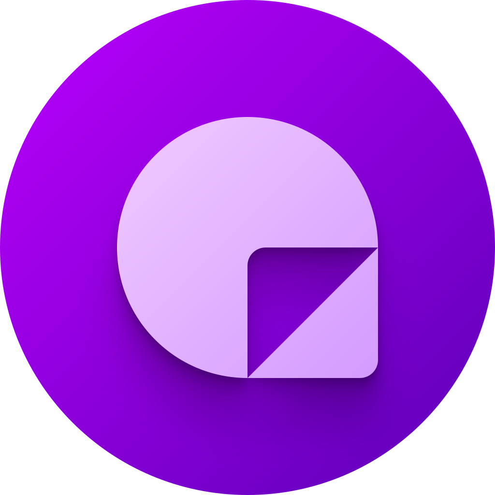

# Noterly

[English](README.md) | **한국어**

Android 기기를 위한 간단한 알림 리마인더 앱입니다.

[tomc128/noterly](https://github.com/tomc128/noterly)의 개인 포크입니다. 1.4.3 베타(`localisation-v2`)를 바탕으로
빌드 도구를 올리고, 버그를 고치고, 몇 가지 기능과 Material 3 Expressive 디자인을 더했습니다. 원작 앱의 공은 모두
Tom Chapman에게 있습니다. 달라진 점은 [이 포크에서 달라진 점](#-이-포크에서-달라진-점)을 보세요.

## 📸 스크린샷

Galaxy S26 Ultra 사양 에뮬레이터(Android 17)의 릴리스 빌드입니다. v1.8.2 코드는 2026-11-06에, 설정·스와이프·
가져오기 스크린샷은 v1.11.0으로 2026-11-21에 찍었습니다.

| 리마인더 목록 | 다크 테마 | 리마인더 편집 |
|:-:|:-:|:-:|
| 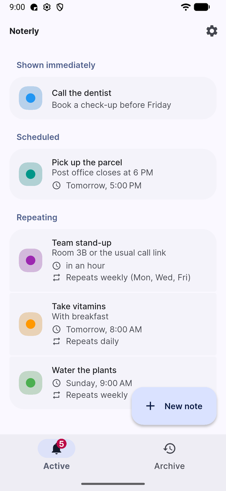 | 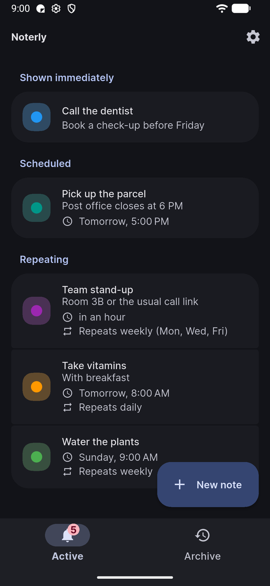 | 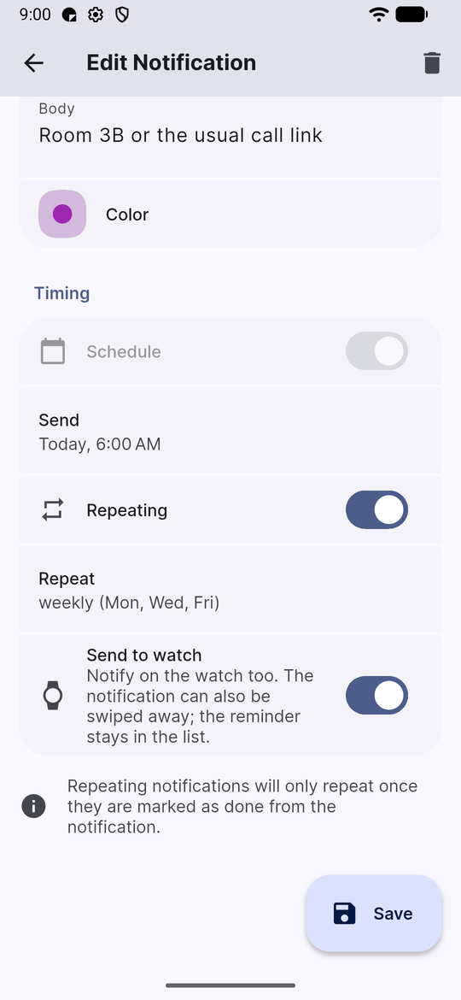 |
| **요일 반복** | **날짜와 시간** | **키패드로 시간 입력** |
| 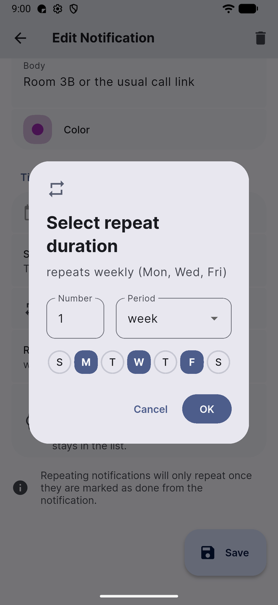 | 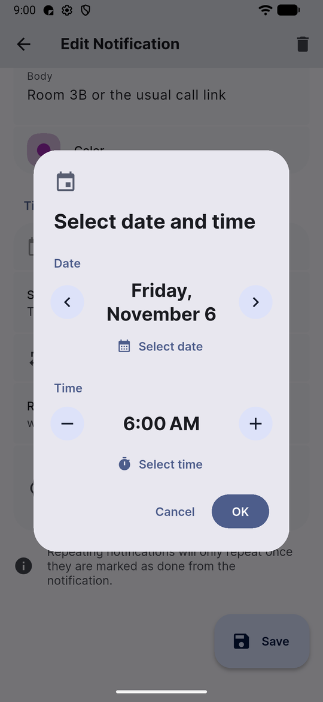 | 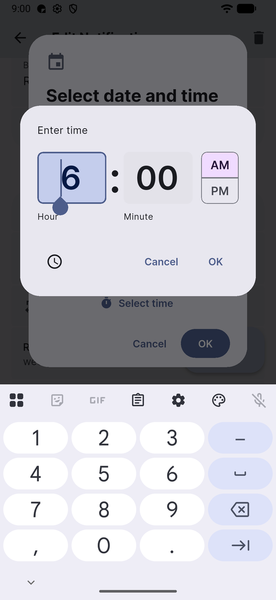 |
| **색상** | **보관함** | **설정** |
| 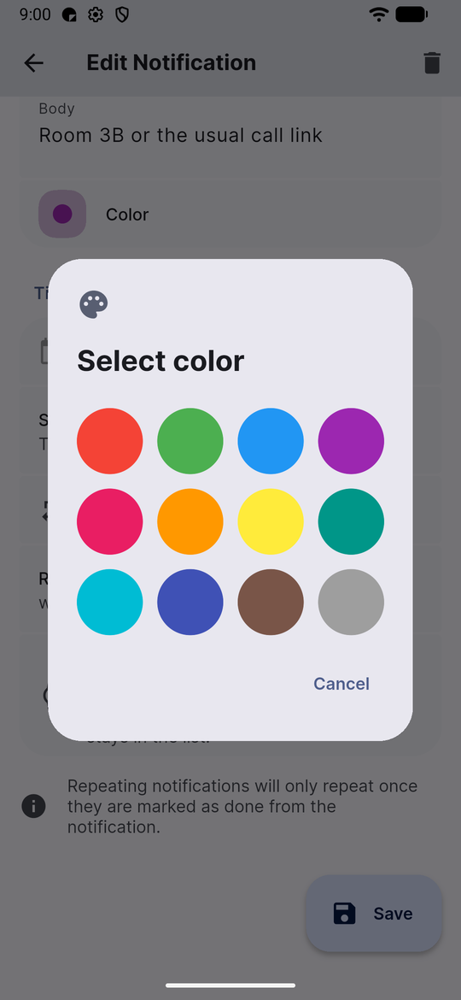 | 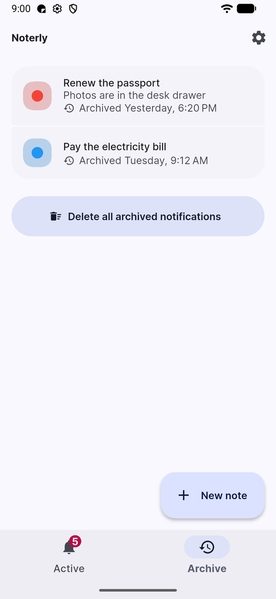 | 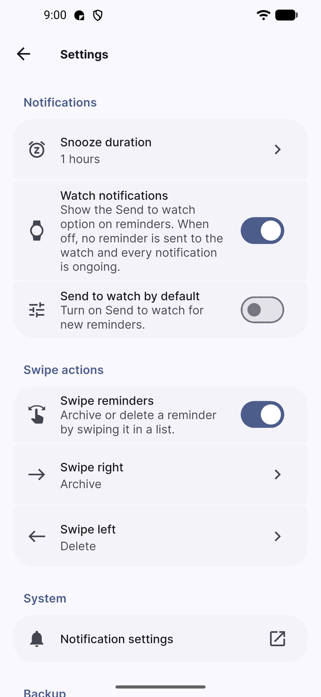 |
| **스와이프로 보관·삭제** | **스와이프 동작 고르기** | **파일에서 리마인더 가져오기** |
| 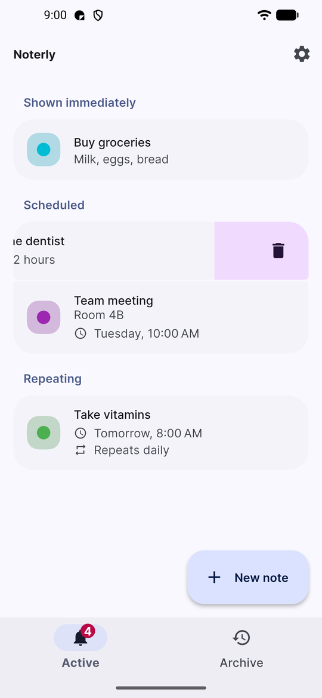 | 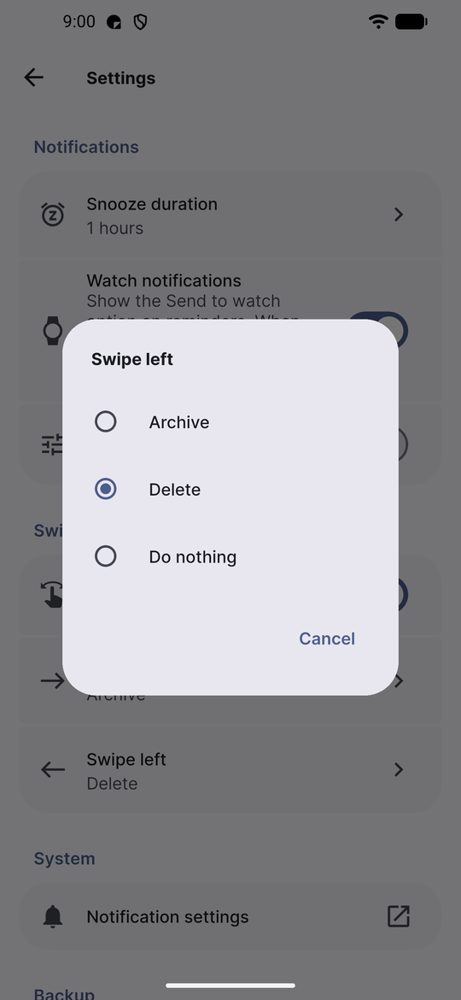 | 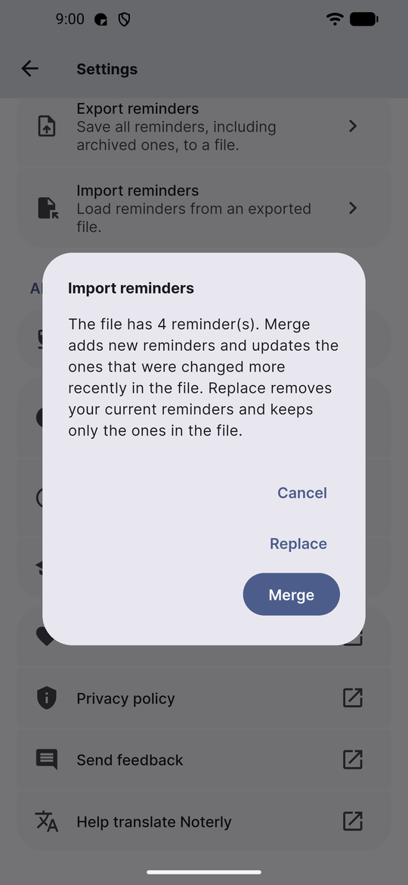 |

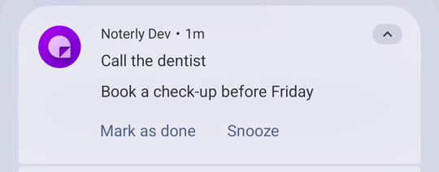

위 스크린샷은 영어 화면입니다. 휴대폰 언어가 한국어이거나, 휴대폰 설정에서 Noterly Dev의 앱 언어를 한국어로 선택하면 앱 화면과 알림이 한국어로 나옵니다.

## 👇🏻 다운로드

이 포크의 APK는 [GitHub 릴리스 페이지](https://github.com/lhh9799/noterly/releases)에 있습니다. 개인용으로 만들어서
**Android 16 이상**용입니다. 릴리스 APK는 `dev` 플레이버라 Play 스토어 앱과 별개인 *Noterly Dev*로 설치됩니다.
v1.8.1부터 예전 디버그 키를 이어받은 릴리스 키(APK 키 순환)로 서명해서, 모든 릴리스가 이전 버전 위에 그대로 업데이트
설치되고 리마인더가 유지됩니다.

릴리스마다 CPU 아키텍처별 APK가 하나씩 있습니다. 대부분의 휴대폰은 `arm64-v8a`, 32비트 ARM 기기는 `armeabi-v7a`,
에뮬레이터와 크롬북은 `x86_64`를 받으세요. Obtainium에서는 앱 설정의 "Attempt to filter APKs by CPU architecture if
possible"을 켜면 알맞은 파일을 고릅니다.

릴리스 번호는 vMAJOR.MINOR.PATCH이고 APK도 같은 버전을 표시하므로, Obtainium 같은 앱이 업데이트가 나왔는지 알 수
있습니다. 2026-11-21까지의 릴리스는 처음에 날짜로 태그를 붙였는데(v2026.10.19-1 ~ v2026.11.21-1), 원작의 마지막 버전(1.4.3)에
이어 v1.5.0 ~ v1.11.0으로 이름을 바꾸고 그 버전명으로 다시 빌드했습니다. 각 릴리스 노트에 예전 태그가 적혀 있습니다.

원작 앱은 [Play 스토어](https://play.google.com/store/apps/details?id=uk.co.tdsstudios.noterly)에서 받을 수 있습니다.

### ⌚ Galaxy Watch 앱

Noterly Watch는 Galaxy Watch용 별도 Wear OS 앱으로, 비공개 저장소에 있습니다. 리마인더를 보여 주고, 워치에서
추가·완료·스누즈할 수 있으며, **Send to watch**가 켜진 리마인더는 워치에서 직접 알림을 울립니다. 두 앱은 같은 키로
서명돼 있어야 서로 연결됩니다.

최신 릴리스: 폰 앱 **v1.15.0**, 워치 앱 **v1.0.1** (2026-11-23 기준).

| 폰 앱 | 호환 워치 앱 |
|---|---|
| v1.8.1, v1.8.2, v1.9.0, v1.10.0, v1.11.0, v1.12.0, v1.12.1, v1.13.0, v1.14.0, v1.15.0 | v1.0.1 |
| v1.7.0, v1.8.0 | v1.0.0 |
| v1.5.0, v1.6.0 | 없음 (워치 동기화 이전) |

## 📝 기능

- ✏️ 제목, 본문, 색상으로 리마인더 만들기
- ⌚ 바로 알리거나 정한 시각에 예약하기
- ⌨️ 숫자 키패드로 시간 입력 (시계 아이콘을 누르면 다이얼로 바뀜)
- 🪃 몇 시간, 며칠, 몇 주, 몇 달, 몇 년마다 반복
- 📅 매주 반복을 알람 시계처럼 요일로 제한, 예: "weekly (Mon, Wed, Fri)"
- ⌚ 리마인더마다 **Send to watch** 옵션: 켠 리마인더만 워치에서 알리고, 폰 알림은 밀어서 지울 수 있음(리마인더는
  목록에 남음). 설정의 *Send to watch by default*로 새 리마인더의 기본값을 정하고, *Watch notifications*로 이 옵션을
  통째로 끌 수 있음
- 💤 원하는 시간만큼 스누즈
- ✅ 알림에서 완료 처리, 완료한 리마인더는 보관함으로 이동
- 👉 목록에서 스와이프로 보관하거나 삭제(실행 취소 가능). 설정에서 오른쪽·왼쪽 스와이프 동작(Archive, Delete,
  Do nothing)을 고르거나 스와이프를 끌 수 있음
- 💾 보관된 것을 포함한 모든 리마인더를 JSON 파일로 내보내고, 병합(Merge) 또는 바꾸기(Replace)로 다시 가져오기
- 🔁 자동 백업: 고른 폴더(예: Documents)에 모든 리마인더의 사본을 두고, 알림 버튼이나 워치에서 바꾼 것까지 바뀔 때마다 갱신하므로 앱을 다시 설치한 뒤 가져올 수 있음
- ☁️ Google 백업: 리마인더와 설정을 각각 휴대폰의 Google 백업에 넣을지 고를 수 있고, 같은 Google 계정으로 앱을 다시 설치하면 돌아옴. 앱에서 휴대폰의 Google 백업 설정을 바로 열 수 있음
- 🏃🏻‍♀️ 빠른 설정 타일에서 리마인더 만들기, 다른 앱의 텍스트를 Noterly로 공유하기
- 🌐 한국어 지원: 휴대폰 언어나 휴대폰 설정의 앱 언어가 한국어이면 화면과 알림이 한국어로 나오고, 줄은 단어 사이에서만 바뀜
- 🎨 Material You 색상과 다크 테마를 쓰는 Material 3 Expressive 화면
- 🔒 분석·오류 보고 없음: 기기 밖으로 나가는 데이터가 없음

## 🔀 이 포크에서 달라진 점

원작 1.4.3 베타와 비교하면:

- **빌드 도구:** Flutter 3.47.7, Gradle 9.5.1, AGP 8.13.0, Kotlin 2.3.20, minSdk 36(Android 16), arm64-v8a·armeabi-v7a·x86_64용 APK
- **Firebase 제거**(Analytics, Crashlytics), Inter 글꼴을 실행 중에 내려받지 않고 앱에 포함
- **새 기능:** 요일 반복, 키패드 시간 입력, Send to watch 옵션(예전 이름 Dismissible)과 설정 스위치(#35), Galaxy Watch
  앱 동기화, 리마인더 내보내기·가져오기, Gmail 방식의 스와이프 설정
- **디자인:** Material 3 Expressive(묶음 목록, 알약 모양 버튼, 더 큰 New note 버튼, 새 대화상자, 빈 화면 그림)
- **버그 수정:**
  - 저장 파일을 읽지 못하면 리마인더가 모두 사라지던 문제(#42)
  - 스누즈한 반복 리마인더가 완료 처리 후 다시 나타나던 문제(#20)
  - 앱이나 워치에서 보관한 리마인더가, 다른 리마인더를 알림에서 완료하면 다시 나타나던 문제
  - 실행 취소 스낵바가 밀어서 지울 때까지 남던 문제
  - 메인 목록 항목 사이 구분이 없고 스크롤이 끊기던 문제
  - 탭을 바꾼 뒤 앱 바 그림자가 남던 문제

자세한 내용: [docs/improvements-2026-10-19.md](docs/improvements-2026-10-19.md),
[릴리스 노트](https://github.com/lhh9799/noterly/releases).

## 🔗 링크

- 원작 Noterly: [Play 스토어](https://play.google.com/store/apps/details?id=uk.co.tdsstudios.noterly)
- 원작 저장소: [tomc128/noterly](https://github.com/tomc128/noterly)
- TDS Studios 웹사이트의 [Noterly 소개 페이지](https://noterly.tdsstudios.co.uk)
- Tom이 Noterly를 만든 과정을 담은 [YouTube 영상](https://youtu.be/7qwUOWT9QbA)
- Tom의 다른 작업이 있는 [개인 웹사이트](https://www.tomchapman.dev)
- TDS Studios 웹사이트의 [Noterly 개인정보 처리방침](https://www.tdsstudios.co.uk/privacy#noterly)

## 🌍 번역

Noterly는 Crowdin으로 번역합니다. [Crowdin 프로젝트](https://crowdin.com/project/noterly)를 참고하세요.

이 포크의 한국어 번역(`noterly/lib/l10n/app_ko.arb`)은 Crowdin이 아니라 이 저장소에서 관리합니다. 고친 뒤에는
`py scripts/l10n/ko_keep_all.py`를 실행하세요. 한국어 단어 안에 보이지 않는 결합 문자(U+2060)를 넣어 줄이 띄어쓰기에서만
바뀌게 합니다.

## ⚠️ 문제 신고

이 포크 빌드의 문제는 [이 포크의 이슈](https://github.com/lhh9799/noterly/issues/new)에 올려 주세요. 원작 앱의 문제는
원작 저장소에 [이슈](https://github.com/tomc128/noterly/issues/new)나
[토론](https://github.com/tomc128/noterly/discussions/new/choose)을 열어 주세요.

## 🔨 빌드 방법

필요한 것: Flutter **3.47.7** stable, JDK 17 이상, Android SDK (`flutter doctor`가 통과해야 함).

1. 저장소를 클론합니다
2. IDE에서 `noterly` **하위 폴더**를 엽니다
3. `flutter pub get`으로 의존성을 설치합니다
4. 두 플레이버 중 하나를 빌드하거나 실행합니다
   - `dev`(앱 ID `uk.co.tdsstudios.noterly.dev`, *Noterly Dev*로 표시):
     `flutter build apk --release --flavor dev`
   - `production`(앱 ID `uk.co.tdsstudios.noterly`, Play 스토어 앱과 같음):
     `flutter build apk --release --flavor production`
   - 연결된 기기에서 실행하려면 `flutter run --flavor dev`

릴리스 빌드는 `android/key.properties`가 있으면 그 키로, 없으면 로컬 디버그 키로 서명합니다. 이 포크의 릴리스 APK는
그다음 릴리스 키와 키 순환 lineage(예전 디버그 키에서 이어받음)로 다시 서명해서, 이전 릴리스 위에 업데이트 설치되고
데이터가 유지됩니다. 저장소 루트에서 `.\scripts\sign-release.ps1`(PowerShell)을 실행하면
`app-dev-release-signed.apk`가 만들어집니다. 키와 lineage는 git이 무시하는 `keys/`에 둡니다.
`.\scripts\release.ps1 -Version 1.11.1`은 Android Gradle이 영문이 아닌 경로를 거부하므로 ASCII 드라이브 문자
(`subst X:`)에서 그 버전으로 dev 릴리스를 빌드한 뒤 서명합니다. `.\scripts\sign-release.ps1 -SavePassword`를 한 번 실행하면 키 비밀번호가 Windows
사용자 계정에 저장되어(DPAPI 암호화, `%LOCALAPPDATA%\noterly\`) 두 스크립트가 다시 묻지 않습니다.
APK는 `noterly/build/app/outputs/flutter-apk/`에 만들어집니다.

릴리스는 GitHub Actions([.github/workflows/release.yml](.github/workflows/release.yml))가 만듭니다. 앱이 바뀐 커밋
(문서나 테스트만 바뀐 것 제외)이 `main`에 푸시될 때마다 테스트, 빌드, 같은 방식의 서명을 거쳐 커밋 메시지로 노트를
쓴 `vMAJOR.MINOR.PATCH` 릴리스를 아키텍처별 APK와 함께 올립니다. 번호는 지난 릴리스 이후의 커밋으로 정합니다. 호환이 깨지는 변경
(`feat!:`이나 `BREAKING CHANGE:`)이 있으면 MAJOR, `feat`이 있으면 MINOR, 그 밖에는 PATCH를 올립니다. APK의 버전명은
그 번호이고 버전 코드는 MAJOR×10000 + MINOR×100 + PATCH입니다. 키, lineage, 비밀번호는 저장소 Secrets에서 가져오며,
`pwsh -File .\scripts\set-ci-secrets.ps1`로 한 번 올려 둡니다. `dry_run`으로 수동 실행하면 릴리스 없이 빌드와 서명만
하고, `rebuild_tag`로 실행하면 기존 릴리스를 그 커밋에서 다시 빌드해 APK를 바꿉니다.
