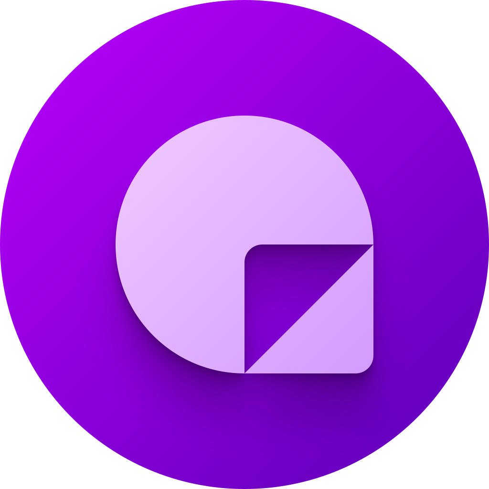

# Noterly
Simple notification reminders for Android devices.

This is a personal fork of [tomc128/noterly](https://github.com/tomc128/noterly). It builds on the 1.4.3 beta
(`localisation-v2`) with an upgraded toolchain, bug fixes, a few new features and a Material 3 Expressive redesign.
All credit for the original app goes to Tom Chapman; see [What's different in this fork](#-whats-different-in-this-fork).

## 📸 Screenshots

Release build on a Galaxy S26 Ultra spec emulator (Android 16, 1080x2340).

| Reminders | Dark theme | Edit a reminder |
|:-:|:-:|:-:|
| 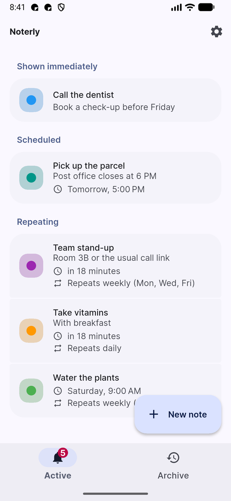 | 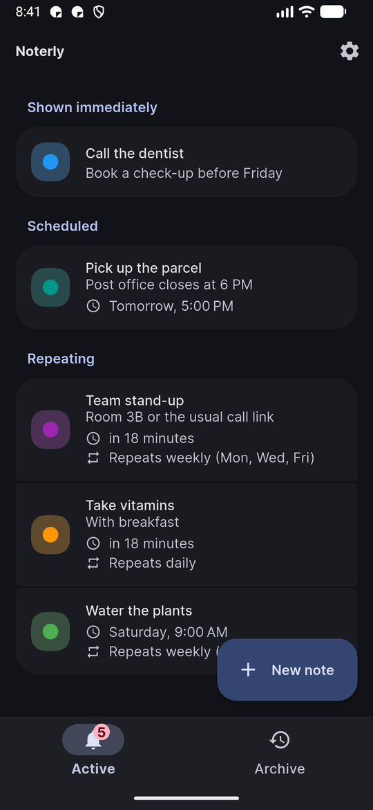 | 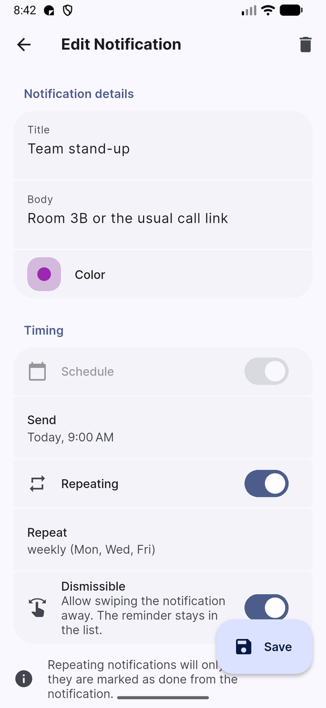 |
| **Repeat on days of the week** | **Date and time** | **Time entry with the keypad** |
| 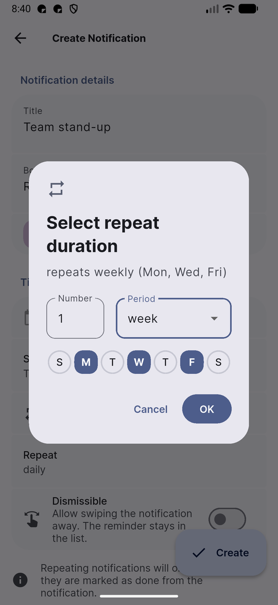 | 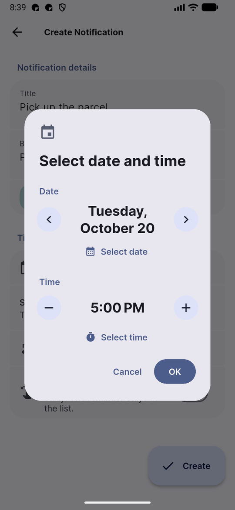 | 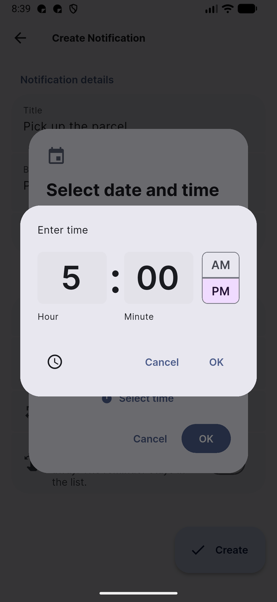 |
| **Colours** | **Archive** | **Settings** |
| 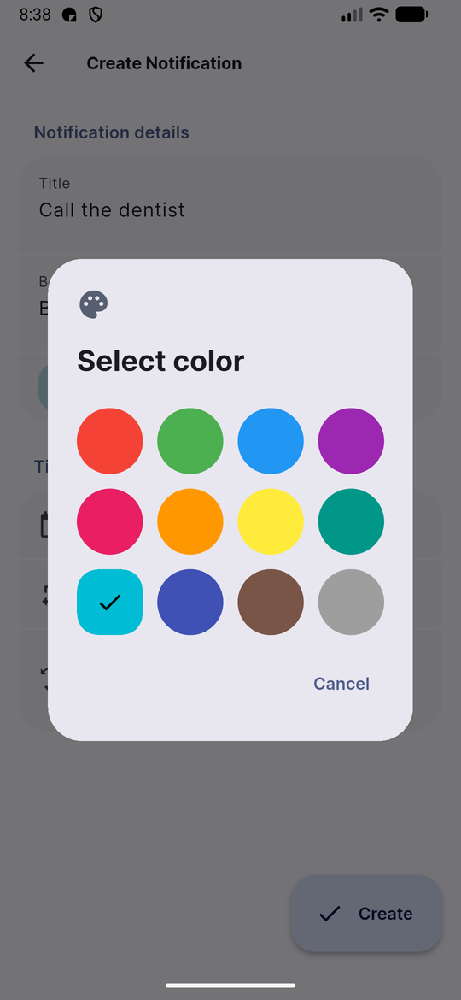 | 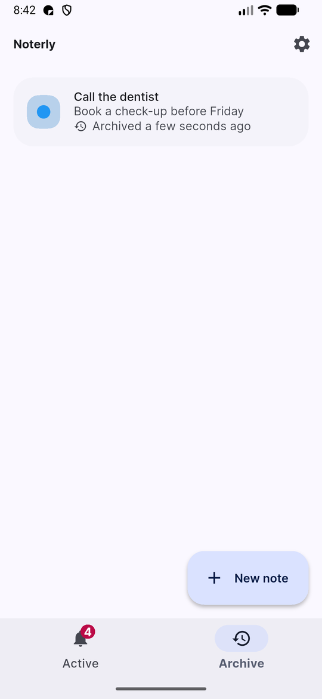 | 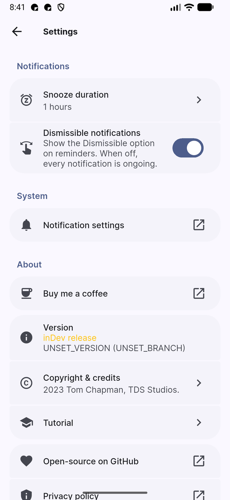 |

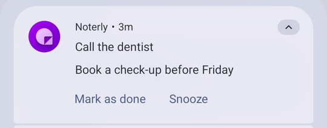

## 👇🏻 Download

APKs of this fork are on the [GitHub releases page](https://github.com/lhh9799/noterly/releases). They are built for
personal use: **Android 16 or newer, 64-bit ARM (arm64-v8a) only**. The release APKs are the `dev` flavour
(installed as *Noterly Dev*, alongside the Play Store app) and are signed with a local key, so later releases install
over earlier ones and keep your reminders.

The original app is available on the [Play Store](https://play.google.com/store/apps/details?id=uk.co.tdsstudios.noterly).

## 📝 Features

- ✏️ Create reminders with a title, body text and a colour
- ⌚ Send reminders instantly, or schedule them for a specific time
- ⌨️ Enter the time with the number keypad (the clock icon switches to the dial)
- 🪃 Repeat reminders every few hours, days, weeks, months or years
- 📅 Weekly repeats can be limited to days of the week, like an alarm clock, e.g. "weekly (Mon, Wed, Fri)"
- ⌚ Per-reminder **Send to watch** option: only these reminders notify on the watch, and their phone notification can
  be swiped away (the reminder stays in the list). Settings has its default for new reminders and a switch to hide it
- 💤 Snooze reminders for a customisable amount of time
- ✅ Mark reminders as done from the notification, or swipe them away in the app (with Undo); done reminders move to the Archive
- 🏃🏻‍♀️ Create reminders from a quick settings tile, or share text to Noterly from other apps
- 🎨 Material 3 Expressive UI with Material You colours and a dark theme
- 🔒 No analytics or crash reporting: nothing leaves the device

## 🔀 What's different in this fork

Compared with the original 1.4.3 beta:

- **Toolchain:** Flutter 3.47.7, Gradle 8.14.3, AGP 8.13.0, Kotlin 2.3.20; minSdk 36 (Android 16), arm64 only
- **Firebase removed** (Analytics and Crashlytics)
- **New:** weekday repeats, keypad time entry, the Send to watch option (formerly Dismissible) and its Settings switches (#35)
- **Design:** Material 3 Expressive look (segmented list groups, pill buttons, larger New note button, reworked dialogs,
  empty-state illustrations)
- **Fixes:**
  - Reminders were all lost when the save file failed to load (#42)
  - A snoozed repeating reminder came back after being marked as done (#20)
  - The Undo snack bar stayed until swiped away
  - No visible separation between items on the main list, and jerky scrolling
  - The app bar shadow stayed after switching tabs

Details: [docs/improvements-2026-10-19.md](docs/improvements-2026-10-19.md) and the
[release notes](https://github.com/lhh9799/noterly/releases).

## 🔗 Links

- Get the original Noterly on the [Play Store](https://play.google.com/store/apps/details?id=uk.co.tdsstudios.noterly)
- The original repository: [tomc128/noterly](https://github.com/tomc128/noterly)
- Check out [Noterly's landing page](https://noterly.tdsstudios.co.uk) on the TDS Studios website
- Watch the [YouTube video](https://youtu.be/7qwUOWT9QbA) on how Tom created Noterly
- Visit [Tom's personal website](https://www.tomchapman.dev) to see what else he's working on
- [Noterly's privacy policy](https://www.tdsstudios.co.uk/privacy#noterly) is available on the TDS Studios website

## 🌍 Translations

Noterly uses Crowdin for translations. You can find the [Crowdin project here](https://crowdin.com/project/noterly).

## ⚠️ Issues

Problems with this fork's builds go to [this fork's issues](https://github.com/lhh9799/noterly/issues/new). For the
original app, [open an issue](https://github.com/tomc128/noterly/issues/new) or
[a discussion](https://github.com/tomc128/noterly/discussions/new/choose) on the original repository.

## 🔨 How to build

Requirements: Flutter **3.47.7** stable, JDK 17 or newer, and the Android SDK (`flutter doctor` should pass).

1. Clone the repository
2. Open the `noterly` **subdirectory** in your IDE of choice
3. Run `flutter pub get` to install the dependencies
4. Build or run one of the two flavours:
   - `dev` (app ID `uk.co.tdsstudios.noterly.dev`, shown as *Noterly Dev*):
     `flutter build apk --release --flavor dev`
   - `production` (app ID `uk.co.tdsstudios.noterly`, the same as the Play Store app):
     `flutter build apk --release --flavor production`
   - or `flutter run --flavor dev` to run on a connected device

Release builds use `android/key.properties` for signing when it exists, and otherwise sign with the local debug key.
The fork's own release APKs are then re-signed with the release key and its rotation lineage (from the old debug
key), so they install over earlier releases and keep their data: `.\scripts\sign-release.ps1` (PowerShell, from the
repository root) writes `app-dev-release-signed.apk`. The key and lineage are kept in `keys/`, which git ignores.
`.\scripts\release.ps1` builds the dev release from an ASCII drive letter (`subst X:`, as Android Gradle refuses the
non-ASCII path) and then signs it. Run `.\scripts\sign-release.ps1 -SavePassword` once to store the keystore password
for your Windows user (DPAPI-encrypted, in `%LOCALAPPDATA%\noterly\`), so neither script asks for it again.
The APK is written to `noterly/build/app/outputs/flutter-apk/`.
