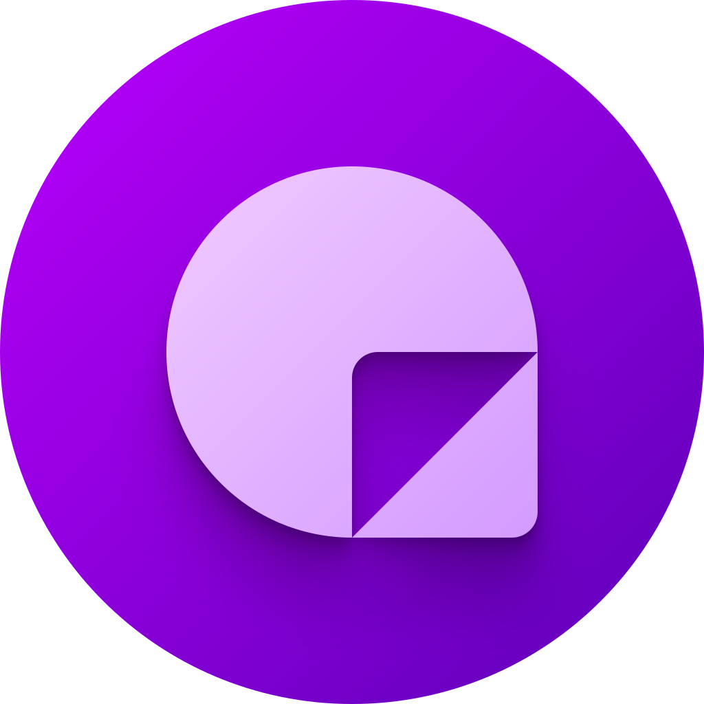

# Noterly

**English** | [한국어](README.ko.md)

Simple notification reminders for Android devices.

This is a personal fork of [tomc128/noterly](https://github.com/tomc128/noterly). It builds on the 1.4.3 beta
(`localisation-v2`) with an upgraded toolchain, bug fixes, a few new features and a Material 3 Expressive redesign.
All credit for the original app goes to Tom Chapman; see [What's different in this fork](#-whats-different-in-this-fork).

## 📸 Screenshots

Release builds on a Galaxy S26 Ultra spec emulator (Android 17): v1.8.2 code, taken 2026-11-06; settings, swipe and
import screenshots from v1.11.0, taken 2026-11-21.

| Reminders | Dark theme | Edit a reminder |
|:-:|:-:|:-:|
| 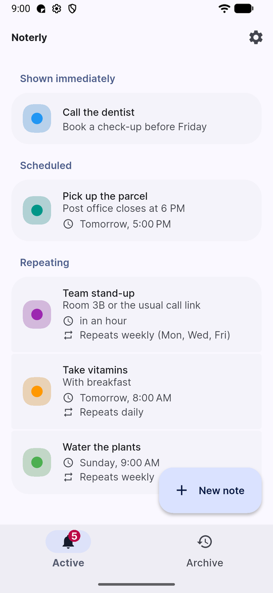 | 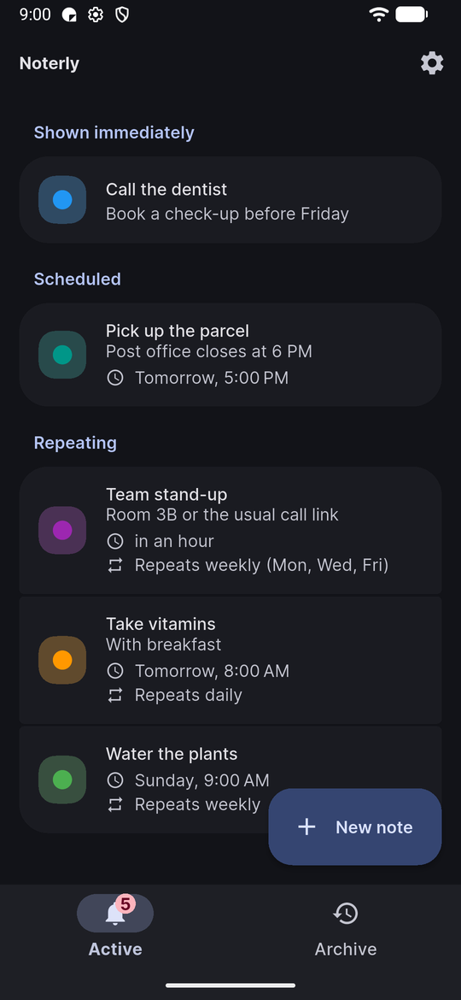 | 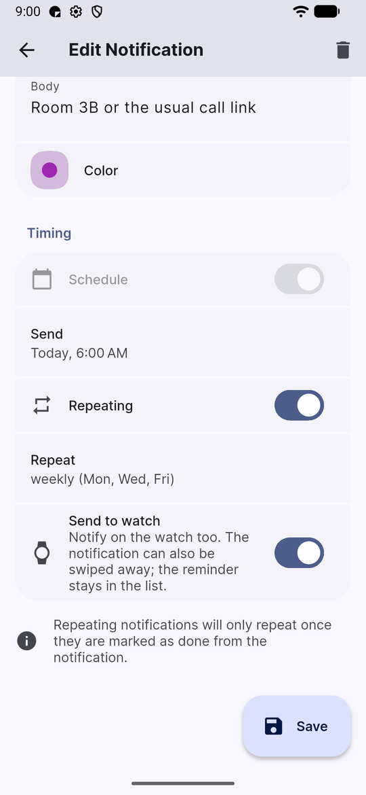 |
| **Repeat on days of the week** | **Date and time** | **Time entry with the keypad** |
| 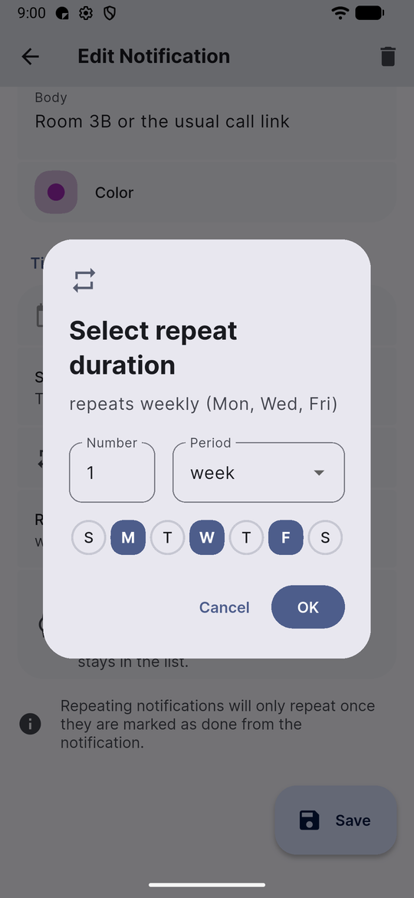 | 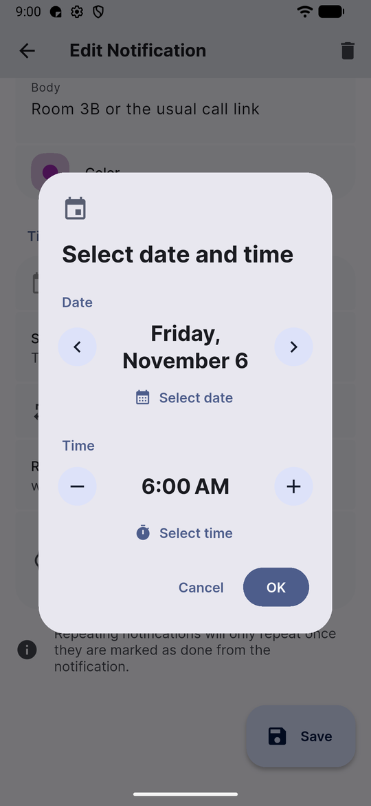 | 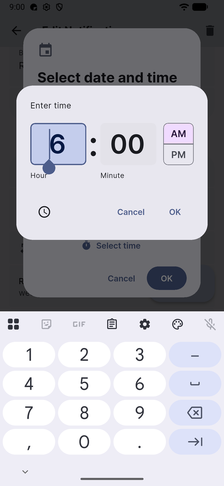 |
| **Colours** | **Archive** | **Settings** |
| 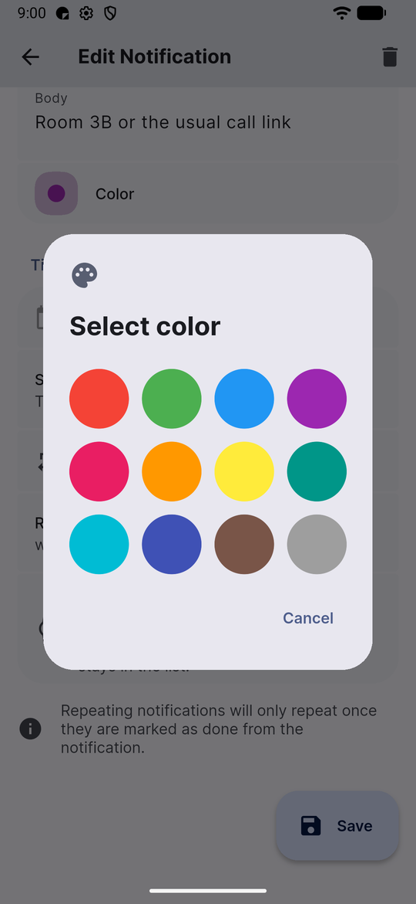 | 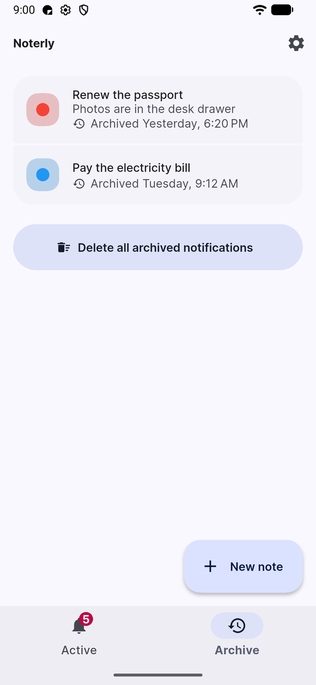 | 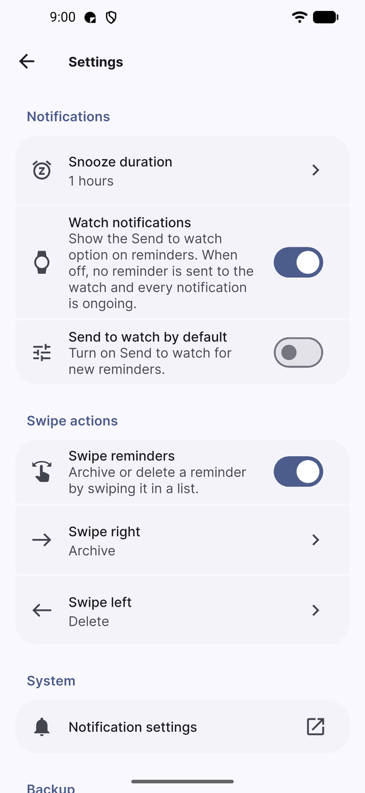 |
| **Swipe to archive or delete** | **Choose what each swipe does** | **Import reminders from a file** |
| 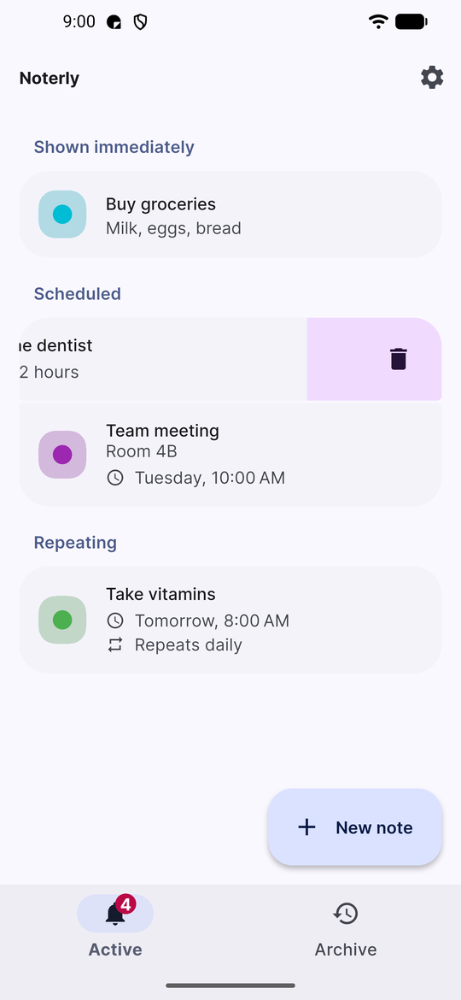 | 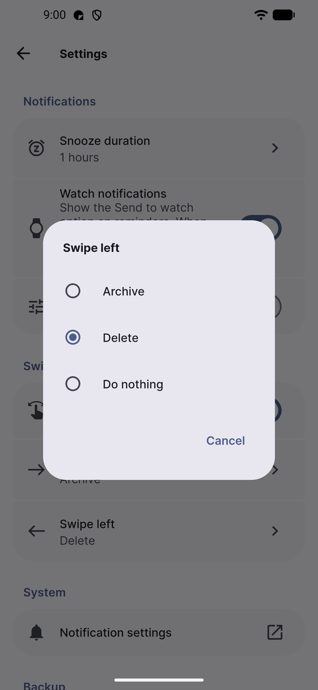 | 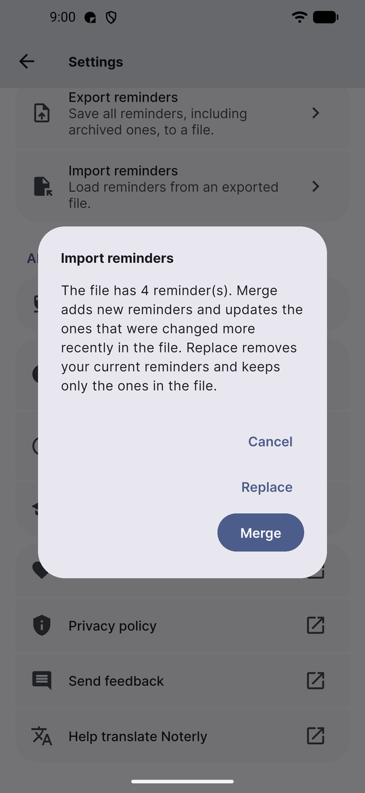 |

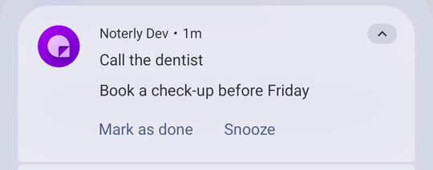

## 👇🏻 Download

APKs of this fork are on the [GitHub releases page](https://github.com/lhh9799/noterly/releases). They are built for
personal use: **Android 16 or newer**. The release APKs are the `dev` flavour (installed as *Noterly Dev*, alongside
the Play Store app). Since v1.8.1 they are signed with a release key that takes over from the earlier debug key (APK
key rotation), so every release installs over the earlier ones and keeps your reminders.

Each release has one APK per CPU architecture: `arm64-v8a` for almost every phone, `armeabi-v7a` for 32-bit ARM
devices and `x86_64` for emulators and Chromebooks. In Obtainium, turn on "Attempt to filter APKs by CPU architecture
if possible" in the app's settings so it picks the right one.

Releases are numbered vMAJOR.MINOR.PATCH, and the APK reports the same version, so apps such as Obtainium can tell
whether an update is out. The releases up to 2026-11-21 were first tagged by date (v2026.10.19-1 to v2026.11.21-1);
they were renamed v1.5.0 to v1.11.0, carrying on from the original app's last version (1.4.3), and rebuilt with those
version names. Each release's notes give its old tag.

The original app is available on the [Play Store](https://play.google.com/store/apps/details?id=uk.co.tdsstudios.noterly).

### ⌚ Galaxy Watch app

Noterly Watch is a separate Wear OS app for the Galaxy Watch, in its own repository, [lhh9799/noterly-watch](https://github.com/lhh9799/noterly-watch). It shows your reminders,
lets you add, finish and snooze them from the watch, and raises alarms on the watch for the reminders with
**Send to watch** on. The two apps only connect when they are signed with the same key. A language picked for this app
under Settings > System > Language is used on the watch too.

Latest releases: phone app **v1.16.1**, watch app **v1.1.0** (as of 2026-11-24).

| Phone app | Compatible watch app |
|---|---|
| v1.8.1, v1.8.2, v1.9.0, v1.10.0, v1.11.0, v1.12.0, v1.12.1, v1.13.0, v1.14.0, v1.15.0, v1.15.1, v1.15.2, v1.16.0, v1.16.1 | v1.0.1, v1.1.0 |
| v1.7.0, v1.8.0 | v1.0.0 |
| v1.5.0, v1.6.0 | none (no watch sync yet) |

## 📝 Features

- ✏️ Create reminders with a title, body text and a colour
- ⌚ Send reminders instantly, or schedule them for a specific time
- ⌨️ Enter the time with the number keypad (the clock icon switches to the dial)
- 🪃 Repeat reminders every few hours, days, weeks, months or years
- 📅 Weekly repeats can be limited to days of the week, like an alarm clock, e.g. "weekly (Mon, Wed, Fri)"
- ⌚ Per-reminder **Send to watch** option: only these reminders notify on the watch, and their phone notification can
  be swiped away (the reminder stays in the list). In Settings, *Send to watch by default* sets it for new
  reminders and *Watch notifications* turns the option off altogether
- 💤 Snooze reminders for a customisable amount of time
- ✅ Mark reminders as done from the notification; done reminders move to the Archive
- 👉 Swipe reminders in the list to archive or delete them (with Undo). In Settings, choose what a right and a left
  swipe do (Archive, Delete or Do nothing), or turn swiping off
- 💾 Export all reminders, archived ones included, to a JSON file, and import them again with Merge or Replace
- 🔁 Automatic backup: a copy of all reminders kept in a folder you choose (such as Documents) and updated after every change, also from notification buttons and the watch, so you can import it after reinstalling the app
- ☁️ Google backup: choose whether the reminders and the settings go into the phone's Google backup (each on its own), so they come back when the app is reinstalled with the same Google account, and open the phone's Google backup settings from the app
- 🏃🏻‍♀️ Create reminders from a quick settings tile, or share text to Noterly from other apps
- 🌐 Korean translation: the screens and notifications follow the phone's language, or the app language chosen for Noterly Dev in the phone's settings (Settings > Language in the app opens it), and Korean lines only break between words
- 🎨 Material 3 Expressive UI with Material You colours and a dark theme
- 🔒 No analytics or crash reporting: nothing leaves the device

## 🔀 What's different in this fork

Compared with the original 1.4.3 beta:

- **Toolchain:** Flutter 3.47.7, Gradle 9.5.1, AGP 8.13.0, Kotlin 2.3.20; minSdk 36 (Android 16); APKs for arm64-v8a, armeabi-v7a and x86_64
- **Firebase removed** (Analytics and Crashlytics), and the Inter font is bundled instead of downloaded at run time
- **New:** weekday repeats, keypad time entry, the Send to watch option (formerly Dismissible) and its Settings switches
  (#35), sync with the Galaxy Watch app, export and import of reminders, and Gmail-style swipe settings
- **Design:** Material 3 Expressive look (segmented list groups, pill buttons, larger New note button, reworked dialogs,
  empty-state illustrations)
- **Fixes:**
  - Reminders were all lost when the save file failed to load (#42)
  - A snoozed repeating reminder came back after being marked as done (#20)
  - A reminder archived in the app or on the watch came back when another one was marked as done from its notification
  - The Undo snack bar stayed until swiped away
  - No visible separation between items on the main list, and jerky scrolling
  - The app bar shadow stayed after switching tabs

Details: [docs/improvements-2026-10-19.md](docs/improvements-2026-10-19.md) and the
[release notes](https://github.com/lhh9799/noterly/releases).

## 🔗 Links

- Get the original Noterly on the [Play Store](https://play.google.com/store/apps/details?id=uk.co.tdsstudios.noterly)
- The original repository: [tomc128/noterly](https://github.com/tomc128/noterly)
- Check out [Noterly's landing page](https://noterly.tdsstudios.co.uk) on the TDS Studios website
- Watch the [YouTube video](https://youtu.be/7qwUOWT9QbA) on how Tom created Noterly
- Visit [Tom's personal website](https://www.tomchapman.dev) to see what else he's working on
- [Noterly's privacy policy](https://www.tdsstudios.co.uk/privacy#noterly) is available on the TDS Studios website

## 🌍 Translations

Noterly uses Crowdin for translations. You can find the [Crowdin project here](https://crowdin.com/project/noterly).

This fork's Korean translation (`noterly/lib/l10n/app_ko.arb`) is kept in this repository, not on Crowdin. After editing
it, run `py scripts/l10n/ko_keep_all.py`: it puts invisible word joiners (U+2060) inside Korean words, so lines only
break at spaces.

## ⚠️ Issues

Problems with this fork's builds go to [this fork's issues](https://github.com/lhh9799/noterly/issues/new). For the
original app, [open an issue](https://github.com/tomc128/noterly/issues/new) or
[a discussion](https://github.com/tomc128/noterly/discussions/new/choose) on the original repository.

## 🔨 How to build

Requirements: Flutter **3.47.7** stable, JDK 17 or newer, and the Android SDK (`flutter doctor` should pass).

1. Clone the repository
2. Open the `noterly` **subdirectory** in your IDE of choice
3. Run `flutter pub get` to install the dependencies
4. Build or run one of the two flavours:
   - `dev` (app ID `uk.co.tdsstudios.noterly.dev`, shown as *Noterly Dev*):
     `flutter build apk --release --flavor dev`
   - `production` (app ID `uk.co.tdsstudios.noterly`, the same as the Play Store app):
     `flutter build apk --release --flavor production`
   - or `flutter run --flavor dev` to run on a connected device

Release builds use `android/key.properties` for signing when it exists, and otherwise sign with the local debug key.
The fork's own release APKs are then re-signed with the release key and its rotation lineage (from the old debug
key), so they install over earlier releases and keep their data: `.\scripts\sign-release.ps1` (PowerShell, from the
repository root) writes `app-dev-release-signed.apk`. The key and lineage are kept in `keys/`, which git ignores.
`.\scripts\release.ps1 -Version 1.11.1` builds the dev release with that version from an ASCII drive letter
(`subst X:`, as Android Gradle refuses the non-ASCII path) and then signs it. Run `.\scripts\sign-release.ps1 -SavePassword` once to store the keystore password
for your Windows user (DPAPI-encrypted, in `%LOCALAPPDATA%\noterly\`), so neither script asks for it again.
The APK is written to `noterly/build/app/outputs/flutter-apk/`.

Releases are made by GitHub Actions ([.github/workflows/release.yml](.github/workflows/release.yml)): every push to
`main` that changes the app (not only docs or tests) is tested, built, signed the same way and published as a
`vMAJOR.MINOR.PATCH` release, one APK per ABI, with notes from the commit messages. The number comes from the commits since the last
release: a breaking change (`feat!:` or `BREAKING CHANGE:`) raises MAJOR, a `feat` raises MINOR and anything else
PATCH. The APK's version name is that number and its version code MAJOR×10000 + MINOR×100 + PATCH. The key, lineage
and password come from repository secrets, uploaded once with `pwsh -File .\scripts\set-ci-secrets.ps1`. A manual run
with `dry_run` builds and signs without publishing; one with `rebuild_tag` rebuilds an existing release from its own
commit and replaces its APK.
